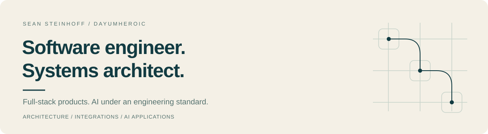

<picture>
  <source media="(prefers-color-scheme: dark)" srcset="assets/header-dark.svg">
  <source media="(prefers-color-scheme: light)" srcset="assets/header-light.svg">
  
</picture>

[Portfolio](https://seansteinhoff.com/) · [LinkedIn](https://www.linkedin.com/in/seantylersteinhoff/) · [Email](mailto:ststeinhoff@gmail.com)

I build software from the architecture through to the product people use. My work spans web and backend systems, API integrations, payments, mobile, wearables and AI applications.

I use AI coding agents for implementation and own the architecture, scope, acceptance criteria and decisions about what ships. The engineering is in how those pieces fit together, how failures are caught and where human judgment stays in control.

## Selected work

### [ProspectPipe](https://github.com/dayumheroic/prospectpipe)
**A prospecting console that researches and drafts. Sending stays with the person.**

I designed and directed its development with AI coding agents. It combines deterministic, explainable scoring with source-backed company research and outreach drafts that a person reviews and sends themselves.

- **Explain the score:** show which rules fired and their weights.
- **Check the premise:** research company facts before drafting.
- **Keep control:** explicit progression, cost previews and a source-scanning gate for known sending patterns.

TypeScript · React · Express · SQLite · Anthropic API · Apollo API  
[Read the project](https://github.com/dayumheroic/prospectpipe#readme) · [Explore the implementation](https://github.com/dayumheroic/prospectpipe/tree/main/server/services)

### Broader systems work

My recent work also includes architecture and development leadership for:

- A solar compliance platform connecting vendor data, renewable energy certificate filings and billing.
- A fitness platform spanning web, mobile and watch applications, with payments, health-data integrations and AI coaching.

Much of this work is private. These summaries describe the scope without publishing client code or unreleased product details.

## How I engineer with AI

I design the development process alongside the software. My approach is to:

1. **Define the outcome.** Focused briefs, explicit scope, a reading list and acceptance criteria.
2. **Bound the work.** Clear tool permissions, retry limits and stop-and-escalate rules.
3. **Separate building from checking.** A fresh review session evaluates the running application against the written standard.
4. **Check the checks.** Deliberate failure cases and mutation testing help establish whether safeguards detect what they claim.
5. **Own consequential decisions.** Production changes, publication and spending stay behind human decisions.

I distinguish written operating rules from controls enforced in code. A green test suite is evidence to examine, alongside the behavior of the application.

## What interests me

AI applications, agent harnesses, orchestration, retrieval and the tooling that makes these systems useful. My focus is application and systems engineering, including running existing models locally.

Open source, self-hosting and developer autonomy matter to me. I build hosted software too. I value tools people can inspect, adapt and choose for themselves.

## Work together

I'm open to remote software engineering and architecture roles, and clearly scoped contract engagements.

[seansteinhoff.com](https://seansteinhoff.com/) · [ststeinhoff@gmail.com](mailto:ststeinhoff@gmail.com)
